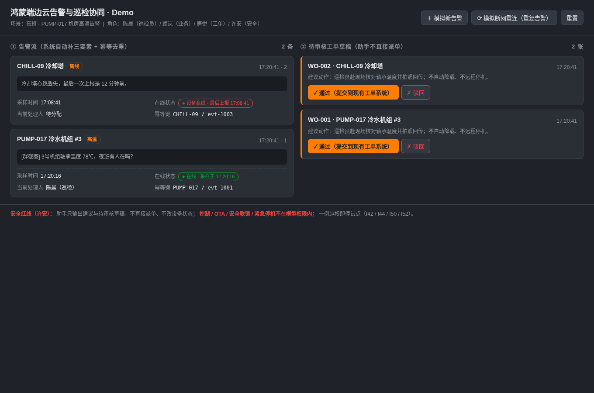

# my-tool · 鸿蒙设备协同微专业案例库

本仓库收录「鸿蒙端边云设备告警与巡检协同」微专业训练过程中的全套报告与任务记录，
按 FDE（发现 → 定义 → 设计 → 构建 → 测试 → 试点 → 上线 → 运营）流程归档。

> 所有案例基于合成场景访谈，需求为待验证假设；不代表真实客户授权、生产上线或实际收益。

## Demo

单文件 HTML 可运行示例：[`examples/demo.html`](examples/demo.html)（双击浏览器打开即可）。



演示覆盖三个 P0 闭环：
1. **告警自动补三要素**：采样时间 / 设备在线状态 / 当前处理人（f10 / f13 / f14）
2. **断网重连幂等去重**：按「设备 + eventId」折叠，不重复开单（f11 / f34 / f35）
3. **只出待审核草稿**：助手不直接派单、不远程停机（f42 / f44 / f50 / f52）

## 方案设计

架构与 MVP 设计（十个关键问题决策表 / 四层架构 / 目录 tree / 数据库表 / 第一周 MVP）见
[`docs/方案设计-架构与MVP.md`](docs/方案设计-架构与MVP.md)。

## 目录结构

```
my-tool/
├── README.md                 # 本文件
├── LICENSE                   # 开源许可证
├── CHANGELOG.md              # 版本记录
├── CONTRIBUTING.md            # 贡献指南
├── requirements.txt          # Python 依赖
├── src/my_tool/              # 源代码（预留）
│   ├── __init__.py
│   ├── main.py
│   ├── core/
│   └── utils/
├── docs/                     # 全阶段报告与流程记录（平铺）
│   ├── design.md             # 设计说明
│   ├── api.md                # 接口说明
│   ├── harmony-fde-flow.md    # FDE 全流程训练记录
│   ├── 方案设计-架构与MVP.md  # 十问决策 / 四层架构 / 表设计 / MVP
│   ├── discovery-report.md → 业务需求发现报告.md
│   ├── 鸿蒙设备协同-{业务挖掘,现场调研,需求定义,方案设计,构建集成,测试评估,客户试点,上线交接,运营迭代}报告.md
│   ├── 工作坊任务记录-*.md
│   └── 各阶段 *-粘贴版.txt
├── tests/                    # 测试（预留）
├── examples/                 # 可运行示例
│   ├── demo.py
│   ├── demo.html             # 告警巡检单文件 Demo
│   └── demo.png              # Demo 截图
├── scripts/                  # 构建 / 部署脚本
│   ├── build.sh
│   └── deploy.sh
├── config/                   # 默认配置
│   └── default.yaml
├── data/                     # 样例数据
└── .github/                  # Issue / PR 模板
    ├── ISSUE_TEMPLATE/
    └── PULL_REQUEST_TEMPLATE.md
```

## 快速阅读顺序

1. [`docs/harmony-fde-flow.md`](docs/harmony-fde-flow.md) — 全流程串联
2. [`docs/业务需求发现报告.md`](docs/业务需求发现报告.md) — 为什么立项
3. [`docs/方案设计-架构与MVP.md`](docs/方案设计-架构与MVP.md) — 十个关键问题、四层架构、表设计、MVP
4. 按 FDE 阶段顺序读各份「鸿蒙设备协同-*报告.md」
5. `*-粘贴版.txt` 是任务执行时的工作稿，可对照正式报告看思路演进

## 安装与运行

```bash
# 克隆
git clone https://github.com/1628222781-eng/my-tool.git
cd my-tool

# Demo：直接用浏览器打开
open examples/demo.html       # macOS
xdg-open examples/demo.html   # Linux
# 或直接双击文件

# （可选）Python 环境
python -m venv .venv && source .venv/bin/activate
pip install -r requirements.txt
```

## 许可证

见 [LICENSE](./LICENSE)。
